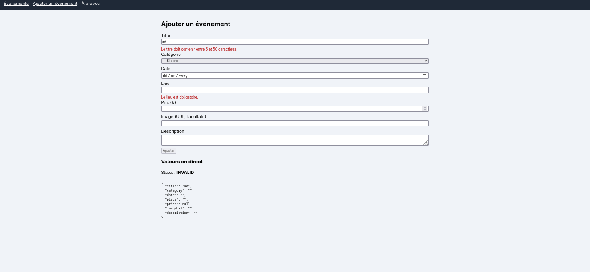
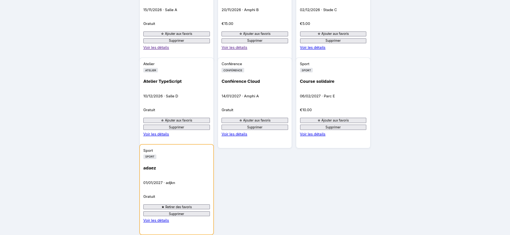
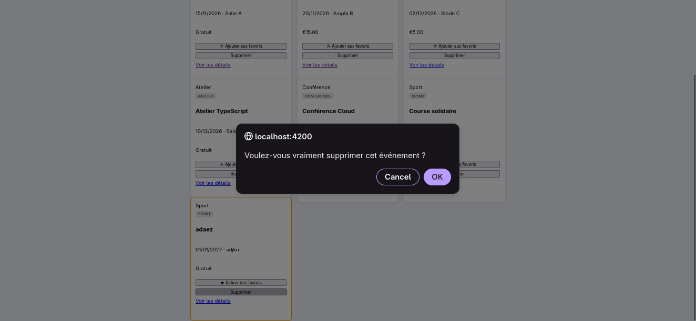

# EventHub

Application Angular 21 standalone réalisée dans le cadre du mini-projet (étude de cas individuelle).
Elle permet à une association étudiante de présenter ses activités (ateliers, conférences, rencontres, compétitions) : consulter la liste des événements, filtrer par catégorie, afficher le détail d'un événement, gérer une sélection de favoris, et ajouter de nouveaux événements via un formulaire.

Le projet fonctionne uniquement côté client : les données sont définies dans le code TypeScript, sans API, base de données ni authentification. Les données sont conservées en mémoire et réinitialisées au rechargement de la page.

**Auteur :** Marouen Nouaigui

## Versions utilisées

- Angular CLI : 21.2.27
- Angular : 21
- Node.js : 24.22.0
- npm : 11.19.1

## Installation et lancement

```bash
git clone https://github.com/nouaigui-marouen/NouaiguiMarouenSSA16_Angular.git
cd NouaiguiMarouenSSA16_Angular
npm install
ng serve -o
```

L'application s'ouvre sur http://localhost:4200 (redirection automatique vers `/events`).

Pour lancer les tests :

```bash
ng test
```

## Structure des composants

```
src/app/
├── app.ts / app.html            Composant racine : Header + <router-outlet>
├── app.routes.ts                Configuration des routes
├── app.config.ts                provideRouter(routes, withComponentInputBinding())
├── models/
│   └── event-item.ts            Type EventCategory et interface EventItem
├── service/
│   └── event.ts                 EventService (Signals privés, asReadonly, computed)
├── components/
│   ├── header/                  Header
│   └── event-card/              EventCard
└── pages/
    ├── event-list/              EventList (lit les données dans EventService)
    ├── event-details/           EventDetails
    ├── event-form/              EventForm (formulaire réactif)
    ├── about/                   About (chargée en lazy loading)
    └── not-found/               NotFound
```

## Rôle des composants

- **Header** : affiche le titre de l'application et le menu de navigation (`routerLink` et `routerLinkActive`).
- **EventService** : source unique des événements et des favoris. Les événements et les favoris sont des Signals privés, exposés en lecture seule avec `asReadonly()`. Les compteurs sont des `computed()`.
- **EventList** : affiche les événements lus dans `EventService`, avec les compteurs, le filtre par catégorie, les favoris et la suppression.
- **EventCard** : présente un événement reçu avec `input()`, signale le clic sur le bouton favori et le bouton de suppression au parent avec `output()`, et propose un lien vers le détail.
- **EventDetails** : récupère l'identifiant de la route et affiche l'événement correspondant, ou un message s'il n'existe pas.
- **EventForm** : formulaire réactif de création d'événement, avec validations, messages d'erreur, valeurs en direct (`toSignal()`) et envoi au service.
- **About** : page de présentation de l'application, chargée en lazy loading avec `loadComponent()`.
- **NotFound** : page affichée pour toute URL inconnue (route `**`).

## Routes

| Route | Composant | Remarque |
|---|---|---|
| `''` | — | Redirection vers `/events` |
| `/events` | EventList | Liste des événements |
| `/events/add` | EventForm | Déclarée avant `/events/:id` pour que « add » ne soit pas lu comme un identifiant |
| `/events/:id` | EventDetails | Route paramétrée |
| `/about` | About | Lazy loading avec `loadComponent()` |
| `**` | NotFound | Page introuvable |

## Fonctionnalités réalisées

- Jeu de données de 6 événements, 3 catégories et 3 événements gratuits, stocké dans `EventService`.
- Signals : `signal()` pour les événements, les favoris et la catégorie sélectionnée ; `computed()` pour les compteurs et la liste filtrée ; modifications avec `set()` et `update()`.
- Compteurs : total, favoris et événements gratuits, mis à jour automatiquement.
- Data binding : interpolation, property binding (`[src]`, `[class.active]`, `[routerLink]`, `[formGroup]`) et event binding (`(click)`, `(ngSubmit)`).
- Control flow : `@for` avec `track`, `@empty` (« Aucun événement disponible »), `@if` / `@else`.
- Pipes : `uppercase`, `date`, `currency` et `json`.
- Communication parent/enfant : `input()` et `output()` entre EventList et EventCard.
- Favoris : ajout et retrait, compteur, état visuel différent (`[class.active]` et `@if/@else`).
- Suppression avec confirmation, qui retire aussi l'événement des favoris.
- Filtre par catégorie : Tous / Atelier / Conférence / Sport.
- Formulaire réactif : `FormGroup`, `FormControl`, `Validators`, `formControlName`, messages d'erreur après touche, bouton désactivé si le formulaire est invalide.
- Valeurs en direct du formulaire avec `toSignal()` (JSON et statut VALID/INVALID).
- Ajout d'un événement depuis le formulaire, avec retour à la liste et affichage immédiat.
- Routage : `provideRouter()`, `<router-outlet>`, `routerLink`, `routerLinkActive`, route paramétrée, redirection et page introuvable.
- Lazy loading de la page About avec `loadComponent()`.
- Mise en page responsive, utilisable sur ordinateur et sur téléphone.

## Tests manuels

### Partie 1

| Cas testé | Résultat |
|---|---|
| Affichage initial | OK |
| Filtre par catégorie | OK |
| Liste vide | OK |
| Ajout et retrait des favoris | OK |
| Navigation vers un détail | OK |
| Identifiant inexistant (`/events/99`) | OK |
| Lien actif | OK |
| URL inconnue | OK |
| Chargement différé de `/about` (onglet Network) | OK |

### Partie 2

| Cas testé | Résultat |
|---|---|
| Formulaire vide : message d'erreur et bouton désactivé | OK |
| Titre trop court | OK |
| Prix négatif (`-5`) : message d'erreur et bouton désactivé | OK |
| Statut INVALID / VALID et valeurs en direct | OK |
| Ajout d'un événement, affichage immédiat, compteurs mis à jour | OK |
| Ajout d'un favori puis suppression : le compteur favoris diminue | OK |
| Détail avec identifiant inexistant | OK |
| Lazy loading de About | OK |
| `ng test` : 4 tests réussis | OK |

## Captures d'écran

### Partie 1


### Partie 2







